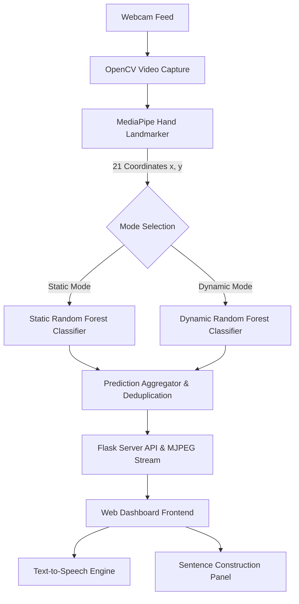

# 🖐️ Real-Time Sign Language Translator

[](https://www.python.org/)
[](https://flask.palletsprojects.com/)
[](https://developers.google.com/mediapipe)
[](https://scikit-learn.org/)
[](https://opencv.org/)
[](https://opensource.org/licenses/MIT)

An intelligent, real-time American Sign Language (ASL) translator powered by **Google MediaPipe Hand Landmarks** and **Scikit-Learn Classifiers**. Features a glassmorphic cyber-HUD web interface, dual recognition modes (static letters & dynamic conversational signs), interactive sentence construction, and text-to-speech (TTS) voice synthesis.

---

## 🌟 Key Features

- **Dual Detection Engines**:
  - **Static Mode**: Recognizes individual letters and static hand configurations (A–Z alphabet finger-spelling).
  - **Dynamic Mode**: Recognizes full conversational phrases (*Hello, Bye, Please, Thank You, Sorry, Yes, No, Help Me, How Are You, I Love You*).
- **Sub-Millisecond Landmark Tracking**: Utilizes Google MediaPipe's 21-point 3D hand landmarker pipeline for robust gesture isolation.
- **Glassmorphic Cyber-HUD Interface**: Dark futuristic UI featuring real-time stream overlays, target reticles, telemetry badges, and live framerate counters.
- **Sentence Assembly & Translation**:
  - **Auto-Append Mode**: Automatically accumulates detected signs into sentences with an adjustable dwell timer.
  - **Manual Correction**: Space to append, Backspace/Clear to reset, and Copy to clipboard.
- **Voice Synthesis (TTS)**: Instant audio playback using the browser's Web Speech API with a server-side `pyttsx3` fallback and customizable speech rate.
- **Interactive ASL Reference**: Built-in modal cheat-sheet with hand pose descriptions for standard ASL alphabet signs.
- **Keyboard Shortcuts**: Designed for hands-free operation:
  - <kbd>Space</kbd> — Append sign
  - <kbd>Enter</kbd> — Speak sentence
  - <kbd>Esc</kbd> — Clear sentence
  - <kbd>1</kbd> — Static mode
  - <kbd>2</kbd> — Dynamic mode
  - <kbd>C</kbd> — Copy sentence to clipboard

---

## 🏗️ Architecture



---

## 📂 Project Structure

```text
sign_language_translator/
├── app.py                  # Core Flask server, MediaPipe pipeline & ML inference
├── requirements.txt        # Python package dependencies
├── models/
│   ├── hand_landmarker.task # MediaPipe pre-trained hand landmark model
│   ├── dynamic_model.p     # Trained classifier for dynamic conversational signs
│   ├── static_data.pickle  # Preprocessed static features dataset
│   └── static_model.p      # (Local) Trained classifier for static ASL signs
├── signs/                  # Dataset images for dynamic gestures (train / valid / test)
│   ├── train/
│   ├── valid/
│   └── test/
├── static/
│   ├── style.css           # Glassmorphic cyber-HUD styling & animations
│   └── script.js           # Client-side streaming, hotkeys, TTS & UI controls
├── templates/
│   └── index.html          # Main web application dashboard
└── README.md               # Project documentation
```

---

## 🚀 Quick Start Guide

### 1. Prerequisites
- **Python 3.9 – 3.11** installed.
- A functional **webcam** (built-in or USB).

### 2. Clone the Repository
```bash
git clone https://github.com/nithinisaimg/sign_language_translator.git
cd sign_language_translator
```

### 3. Set Up Virtual Environment
```bash
# Windows
python -m venv venv
venv\Scripts\activate

# macOS / Linux
python3 -m venv venv
source venv/bin/activate
```

### 4. Install Dependencies
```bash
pip install --upgrade pip
pip install -r requirements.txt
```

### 5. Run the Application
```bash
python app.py
```

### 6. Open the Dashboard
Open your browser and navigate to:
```
http://localhost:5000
```

---

## 🧠 Model Training & Data

### Included Models
- **`models/hand_landmarker.task`**: Google MediaPipe vision task file for 21-point 3D hand tracking.
- **`models/dynamic_model.p`**: Pre-trained Random Forest model for conversational phrases trained on the included `signs/` dataset.
- **`models/static_data.pickle`**: Processed landmark features for static ASL letters.

### Static ASL Model (`models/static_model.p`)
Because GitHub enforces a **100 MB hard limit** on individual files, the compiled `models/static_model.p` (~130 MB) and raw image dataset `ASL_Dataset` (~4 GB) are excluded via `.gitignore`.

You can generate or retrain the static model locally in one of two ways:
1. **From Preprocessed Landmarks**: Train directly using `models/static_data.pickle`.
2. **From Image Dataset**: Download the [ASL Alphabet Dataset](https://www.kaggle.com/datasets/grassknoted/asl-alphabet), extract it into `ASL_Dataset/` with `train/` and `test/` folders, and trigger `/retrain` via the dashboard UI or by setting:
   ```bash
   # Windows PowerShell
   $env:FORCE_TRAIN="1"; python app.py

   # Linux/macOS
   FORCE_TRAIN=1 python app.py
   ```

---

## 🛠️ Tech Stack

| Component | Technology | Description |
|---|---|---|
| **Backend** | Python & Flask | Lightweight REST API and MJPEG stream server |
| **Vision AI** | Google MediaPipe | Sub-pixel hand landmark extraction (21 points) |
| **Machine Learning** | Scikit-Learn | Random Forest multi-class classifiers |
| **Image Processing** | OpenCV (`cv2`) | Camera capture, frame transformations & drawing |
| **Audio / TTS** | Web Speech API / `pyttsx3` | Client-side speech synthesis with local fallback |
| **Frontend** | HTML5, CSS3, JavaScript | Modern glassmorphism UI with HUD telemetry |

---

## 🤝 Contributing

Contributions, issues, and feature requests are welcome!
1. Fork the Project
2. Create your Feature Branch (`git checkout -b feature/AmazingFeature`)
3. Commit your Changes (`git commit -m 'Add some AmazingFeature'`)
4. Push to the Branch (`git push origin feature/AmazingFeature`)
5. Open a Pull Request

---

## 📄 License

Distributed under the MIT License. See `LICENSE` for more information.

---

**Crafted with passion for accessibility and computer vision.**
